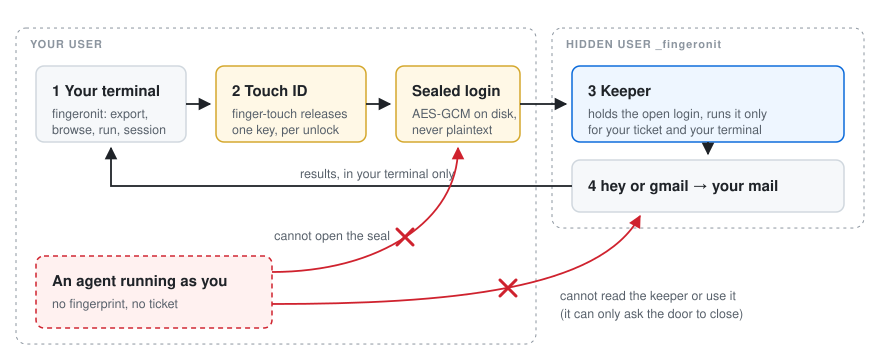

# fingeronit

**You have to put your finger on it (Touch ID, or your Mac password) before an agent, or anything else, can do an email action.** A lock for macOS in front of mail CLIs: Basecamp's [HEY CLI](https://www.hey.com/agents/) (`hey`) and Gmail (`gmail`).

Mail CLIs are great at handing your mail to agents. fingeronit is for the times you want them to hand your mail only to *you*. Your login stays encrypted on disk and opens only after Touch ID, in your own terminal, for one command or session at a time. Each sign-in ("instance") belongs to one provider, `hey` or `gmail`.



> fingeronit is an independent project. It is not made or endorsed by Basecamp, HEY or Google.

## Why

On a Mac, a mail CLI keeps your login where any program running as you can usually use it with no prompt. That includes coding agents, scripts, and anything you installed last week. fingeronit closes that gap:

- **Sealed at rest.** The login is AES-GCM encrypted in `var/instances/<name>/sealed.box`. The key sits in your login keychain, and only fingeronit's signed `finger-touch` helper can read it.
- **Touch ID per unlock.** Every export, command or session asks for your fingerprint, and the prompt says what is being run.
- **Terminal only.** A pipe, or a shell with no terminal, is refused.
- **Out of your user's reach while open** (optional, one `sudo`). A hidden `_fingeronit` user holds the open login, and runs `hey` or `gmail` only for the terminal that opened it.
- **Shuts itself.** 20 minutes with no keys pressed and the door closes and reseals.

## Quick start

You need macOS on Apple silicon and the Xcode command line tools (`xcode-select --install`). The Gmail provider (`lib/providers/gmail.py`) runs on the system `/usr/bin/python3`.

```sh
git clone https://github.com/realityinspector/fingeronit.git
cd fingeronit
bin/build                  # compile finger-touch, fetch and verify the pinned HEY CLI
bin/fingeronit doctor          # checks everything, never unlocks
./fingeronit                   # the menu: sign in once (HEY or Gmail), then pick what to do
sudo bin/install-keeper    # optional, recommended: move the open login out of your user's reach
```

Optional: `source bin/activate` puts `fingeronit` on your `PATH` from anywhere, and makes a bare `hey` refuse. It unlocks nothing.

### Providers

| Provider | Command | Config dir (inside the sealed login) | Notes |
| --- | --- | --- | --- |
| `hey` (default) | `libexec/hey`, the pinned HEY CLI | `hey-cli` | Has HEY's contact thread lists and full-screen view. |
| `gmail` | `/usr/bin/python3 -I lib/providers/gmail.py` | `fingeronit-gmail` | Search, read, attachments and drafts only. No contact lists, no full-screen view. |

`fingeronit login [--provider hey|gmail] [NAME]` signs one in. The choice is saved as `var/instances/<name>/provider` (no file means `hey`), and shown in the menu and in `fingeronit status`. The provider table lives in one place in `bin/fingeronit`, and is mirrored in `lib/keeper`.

**Gmail setup:** Google does not let apps share one login, so you make your own free OAuth client (a "Desktop app", about five minutes) and hand its JSON file to `fingeronit login --provider gmail --client FILE` (or answer the question it asks). [docs/gmail.md](docs/gmail.md) walks through it. The Gmail provider asks Google only for `gmail.readonly`: it can read, never send, change or delete.

Through the keeper, `gmail` may do only: `search`, `thread read`, `attachment list`, `attachment save`, `draft list`, `draft show`, `auth status`, `version`, and `help`. Everything else is refused.

## Using it

`./fingeronit` opens a one-screen menu. The top line says where things stand: locked, open in this session, busy in another terminal, or left open by a crash. Arrows or `j`/`k` move, enter or a number picks, `?` is help, `r` refreshes, `q` quits.

| Menu choice | What it does |
| --- | --- |
| **Sign in** | Asks `Provider [1 HEY, 2 Gmail]`, signs in in your browser, then seals the login. |
| **Export mail** | Five questions (address, which mail, days, file type, folder), then you tick threads. Writes one markdown and/or PDF file, with attachments. |
| **Browse mail** | HEY only: HEY's own full-screen view. Quitting it shuts the door. |
| **Run a hey (or gmail) command** | One command, like `box list` for HEY, then shut. |
| **Open a shell session** | `hey` (or `gmail`) works until you `exit`. Inside it, `fingeronit` opens that session's menu with no second fingerprint. |
| **Remove an older HEY CLI login** | Shown when an older, unprotected HEY CLI login is on this Mac. |
| **Switch instance / Destroy / Check this box / Help** | A second sign-in, shredding one, `doctor`, and the help page. |

### Exports

- **Which mail.** `1` is mail from the address. `2` is everything to and from it: their mail, mail you sent them, any thread that names the address, and your drafts to them (marked `[draft]`, with To, Cc, Bcc and body).
- **Complete, not just search hits.** With HEY, fingeronit joins HEY's search with the contact's own thread list, because search alone can miss most threads. Gmail has no such list, so it uses search only. Each thread appears once.
- **Attachments** are saved beside the file. The same file attached twice is saved once, and a different file with the same name becomes `name (2).ext`.
- **Temporary by default.** Exports go to `~/fingeronit-export` (not synced by iCloud), and are deleted when fingeronit closes. First fingeronit lists what is there and asks you to move out what you want to keep: `o` opens Finder, `d` deletes. Ctrl-C does not skip that question. A folder you pick yourself with `--to` is left alone.
- **If the terminal dies.** Closing the window, Terminal crashing, or the idle timer deletes the exports with no question, and reseals any open door. A fingeronit killed outright (`kill -9`, power loss) cannot clean up, so the next fingeronit you start sees exports whose owner is gone, says so, and deletes them when it closes. Exports owned by a fingeronit still running in another terminal are left to that one. A dropped network only marks the threads it could not read; the door still reseals, because that needs no network.

### Commands

| Command | What it does |
| --- | --- |
| `fingeronit` | The menu. |
| `fingeronit export --from ADDR [--from ADDR2] [--days N \| --all-time] [--md \| --pdf \| --both] [--to DIR] [--open]` | Export mail from one or more senders, no questions. |
| `fingeronit export --with ADDR ...` | The same, for everything to and from the address, drafts included. |
| `fingeronit run -- box list` | One provider command, then shut. |
| `fingeronit session` | A shell where `hey` (or `gmail`) works until `exit`. |
| `fingeronit status` | Provider, seal, door and keeper state. Never unlocks. |
| `fingeronit doctor` | Checks the hey binary's checksum, the flags fingeronit relies on in each provider, and tools. Skips Gmail with a clear line if `lib/providers/gmail.py` is missing. Never unlocks. Run it after HEY or gmail.py changes. |
| `fingeronit login [--provider hey\|gmail] [--client FILE] [NAME]` | Sign in. The default instance is `temp`, the default provider `hey`. `--client` is your Google OAuth client file, for Gmail. |
| `fingeronit seal-live` | Puts a crashed session's login back in the seal. |
| `fingeronit clean` | Shreds scratch that an abandoned session left behind. This also happens on its own at start. |
| `fingeronit clean-old` | HEY only: removes an older HEY CLI login (`~/.config/hey-cli` and the keychain item `hey`) after you type REMOVE. |
| `fingeronit destroy [--all]` | Shreds a seal and its key, or everything. |
| `fingeronit version` | The version. |

For HEY, `fingeronit run` and `fingeronit session` refuse `setup`, skills, `mcp`, `config`, every `auth` command but `auth status`, `--base-url`, and `-v`, wherever global flags put them in the command line. For Gmail they allow only the short list above.

## The keeper (one sudo, recommended)

```sh
sudo bin/install-keeper            # install or update
sudo bin/install-keeper --remove   # take it all back out
```

Without the keeper, an open door is a folder your user owns, so your other programs could read it while it is open. With it:

- a hidden macOS user, `_fingeronit`, holds the open login in `/private/var/fingeronit`, which only that user can read;
- one sudoers rule (`/etc/sudoers.d/fingeronit`) lets you run the keeper as `_fingeronit`, and nothing else;
- the keeper runs `hey` (or `gmail.py`) only for the fingeronit that opened the door, which proves itself with a random ticket, from the same terminal;
- anything else running as you can ask the door to close, and nothing more.

Files go to `/usr/local/libexec/fingeronit` (root-owned): the keeper, `hey`, `seal`, and `gmail.py` when `lib/providers/gmail.py` exists. The installer checks the HEY binary against its checksum, has `visudo` check the rule before adding it, and ends with a self-test. Run it again after updating HEY, gmail.py or fingeronit. It runs a script from your own checkout as root, so read it first, and keep the checkout writable only by you.

## What it protects, and what it does not

| Protected | Not protected |
| --- | --- |
| Your HEY or Gmail login on disk: encrypted, with the key behind Touch ID. | The first sign-in, which happens on your side before it is sealed. |
| The open login, from other programs running as you (with the keeper). | A program running as you can type into your terminal while a session is open. Keep untrusted programs out of that terminal. |
| `hey` or `gmail` being run without you: every unlock needs your fingerprint, and names the command. | A Touch ID prompt you approve without reading. Cancel any you did not just ask for. |
| Injected code skipping Touch ID: `bin/build` signs with the hardened runtime. | Exports, while they exist. Deleted files can survive in Spotlight, Time Machine snapshots, or APFS free space. |
| Token printing and settings changes through `fingeronit run`. | The audit log under `var/instances`, which records times, senders and commands in plain text. |

This is one padlock, not a regulated control.

### How the lock works

1. A command or session that needs mail asks `finger-touch` for the key. `finger-touch` asks for Touch ID (or your Mac password if biometrics are unavailable). The keychain item trusts that signed binary only, so `security` cannot read it quietly.
2. `finger-touch` decrypts the sealed login and streams it, with the key, straight into the keeper. Nothing secret is written to a file on your side.
3. The keeper unpacks the login (only the active provider's config dir is allowed in the archive) where only it can read it, and hands back a ticket. `hey` or `gmail.py` runs through the keeper with that ticket, from that terminal.
4. When the command, session or idle timer ends, the keeper reseals the login with the same key and shreds the open copy. A login is only sealed back if it was opened with this box's own key.
5. A watchdog reseals if fingeronit is killed. If a crash still leaves scratch behind, fingeronit shreds it on the next start, once no door is open.

### An older HEY CLI login

If the HEY CLI was set up on this Mac before fingeronit, its login may still be in `~/.config/hey-cli` or in your keychain under `hey`, where any copy of `hey` can use it without a fingerprint. The menu flags it, and `fingeronit clean-old` removes it. Then, on hey.com, disconnect any sign-in you do not recognize, and keep the one fingeronit uses.

## For AI agents

If you are an AI agent working in a checkout of this repo, read [`AGENTS.md`](AGENTS.md) first. In short:

- **Do not** run `hey`, `gmail`, `fingeronit`, `finger-touch`, `finger-seal`, `lib/providers/gmail.py`, or anything in `libexec/`.
- **Do not** read `var/`, audit logs, sealed files, `~/fingeronit-export`, `~/.config/hey-cli`, or `~/.config/fingeronit-gmail`.
- **Do not** search, list, or summarize the user's email. If they ask you to fetch mail, tell them which `fingeronit` command to run in their own terminal.
- **You may** read and edit the source (including `lib/providers/`), and run `bin/ux-test`, which drives the whole menu against stub binaries and a stub Gmail provider, a fake home folder and a fake keychain under `/tmp`. It never touches a real seal or real mail.

| Path | What it is |
| --- | --- |
| `bin/fingeronit` | The CLI and menu (bash), and the provider table. |
| `lib/keeper` | Holds an open login; runs `hey` or `gmail.py` only for its ticket (bash). Mirrors the provider table. |
| `lib/providers/gmail.py` | The Gmail provider: a CLI with the same JSON shapes as `hey`'s, on `/usr/bin/python3`. |
| `lib/FingerTouch.swift` | Touch ID, the keychain key, seal and unseal. Builds `bin/finger-touch`. |
| `lib/FingerSeal.swift` | Seals what the keeper holds. Builds `bin/finger-seal`. |
| `bin/install-keeper` | Creates `_fingeronit`, installs the keeper (and `hey`, `gmail.py`), adds the sudoers rule. |
| `bin/build` | Compiles and signs the Swift tools; fetches and verifies the pinned HEY CLI. |
| `bin/activate` | Puts fingeronit on `PATH`; makes a bare `hey` refuse. |
| `bin/ux-test` | End-to-end test of the menu and exports on stubs, for both providers. |
| `lib/providers/gmail.py` | The read-only Gmail client (Python, standard library only). |
| `tests/test_gmail.py` | Its unit tests, against a fake Gmail. |
| `docs/gmail.md` | How to make your own Google OAuth client. |
| `lockenv.cfg` | The pinned HEY release and checksums, and `idle_minutes`. |
| `docs/fingeronit.svg` | The diagram above. |
| `libexec/hey`, `bin/finger-touch`, `bin/finger-seal` | Built by `bin/build`. Not in git. |
| `var/` | Seals, audit logs, and the open door when no keeper is installed. Not in git. Never read it. |

## Building and testing

- `bin/build` compiles `lib/FingerTouch.swift` and `lib/FingerSeal.swift` with `swiftc -O`, signs them ad hoc with the hardened runtime, downloads the HEY CLI release pinned in `lockenv.cfg`, and checks both the archive (`asset_sha256`) and the `hey` binary (`binary_sha256`). Any mismatch stops it. `--no-hey` skips the download.
- **Do not rebuild `bin/finger-touch` after you have used fingeronit.** The keychain trusts that exact signed binary, so a rebuilt one cannot reach the old key, and your seal is lost. `bin/build` refuses unless you pass `--force`.
- **Intel Macs:** `lockenv.cfg` pins the Apple silicon release. Set `hey_asset` to the `darwin_amd64` file from the [hey-cli releases](https://github.com/basecamp/hey-cli/releases) and update both checksums.
- `bin/ux-test` must end with `ux-test ok`. It also runs the Gmail provider's unit tests (`python3 -I -m unittest discover -s tests`), which fake Google's servers and never go online.
- `idle_minutes` in `lockenv.cfg` sets the auto-close (0 turns it off).

## Remove it

```sh
fingeronit destroy                     # type DESTROY, then a fingerprint: one instance
fingeronit destroy --all               # every instance, the key, and the hey binary
sudo bin/install-keeper --remove   # the _fingeronit user, its folder, the sudoers rule
```

Then delete the folder. Destroying the local seal does not revoke the provider's grant (neither does `hey auth logout`), so if HEY or Google still lists the sign-in, disconnect it on hey.com or in your Google account.

## License

MIT. See [LICENSE](LICENSE).
